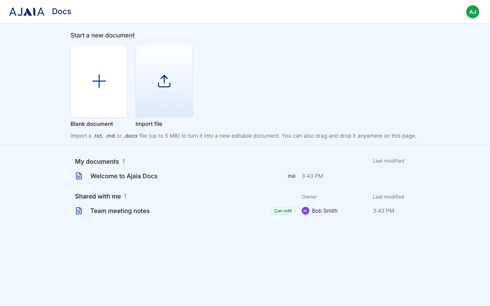
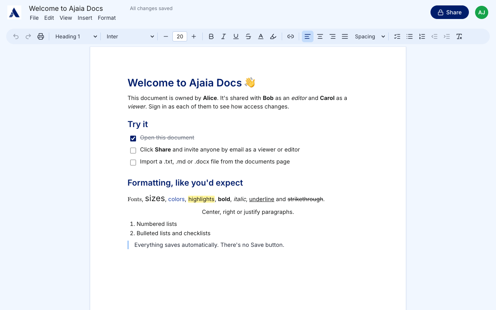
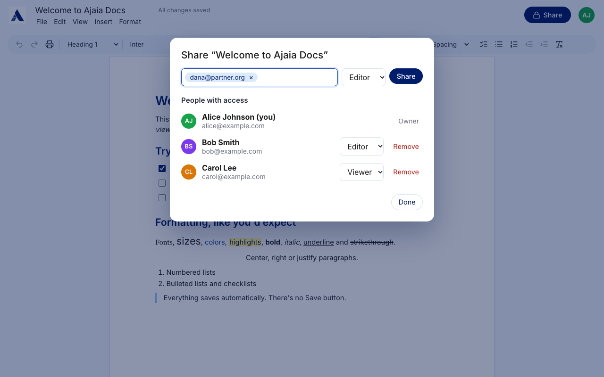
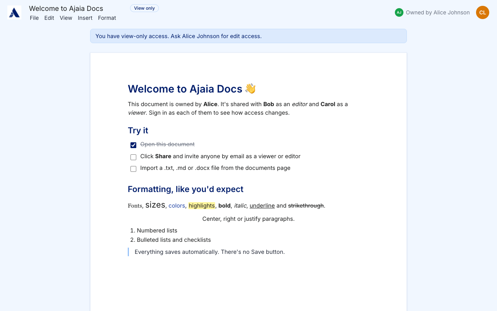

# Ajaia Docs: Lightweight Collaborative Document Editor

A full-stack document editor inspired by Google Docs, in Ajaia's brand. Create and format documents, import `.txt`, `.md` and `.docx` files, and share documents by email with viewer or editor access. Everything saves automatically.

> **Live demo:** **https://ajaia-docs-e26f.onrender.com** (Render free tier: the first visit after about 15 minutes idle takes about 50 seconds to wake up)
> Sign in with one click as **Alice**, **Bob** or **Carol** (no password), or use any email address.
>
> More detail: [ARCHITECTURE.md](ARCHITECTURE.md) (design and tradeoffs) · [TESTING.md](TESTING.md) (test rounds and issues found) · [AI_WORKFLOW.md](AI_WORKFLOW.md) (how AI was used)

| Docs home | Editor |
|---|---|
|  |  |
| **Share dialog** | **Viewer (read-only)** |
|  |  |

---

## Features

**Editing (Google Docs-style)**
- **Menu bar:**
  - **File:** new, import, share, rename, download as `.html` or `.txt`, print.
  - **Edit:** undo, redo, select all.
  - **View:** word count, show or hide the toolbar.
  - **Insert:** link, horizontal line, checklist, quote, code block.
  - **Format:** text styles, paragraph styles, alignment, line spacing, clear formatting.
- **Toolbar:**
  - Undo/redo and print.
  - Paragraph style (Normal, Heading 1–3), **font family**, and **font size** with −/+ buttons.
  - **Bold**, *italic*, underline, strikethrough, **text color** and **highlight**.
  - Link, **alignment** (left, center, right, justify) and **line spacing**.
  - **Checklists**, bulleted and numbered lists, indent, and clear formatting.
- **Autosave:** "Saving…" then "All changes saved", with no Save button. When the server is unreachable it shows "Offline. Retrying…" and recovers by itself. It saves before you leave the page or sign out. Cmd/Ctrl+S saves immediately.
- A **paper page** layout, a title you edit inline, keyboard shortcuts (⌘B/I/U/K/Z/Y/\\), markdown shortcuts (`# `, `- `, `1. `, `> `, `---`), and a print layout that prints only the page.

**Files:** import `.txt`, `.md` or `.docx` (up to 5 MB) as a new editable document, using the Import tile, drag-and-drop, or File → Import.

**Sharing:**
- Every document has an owner. Share by email with several people at once as a **Viewer** or **Editor**, change roles, or **remove** access.
- The home page has **My documents** and **Shared with me** sections.
- Permissions are **enforced on the backend**.

**Branding:** Ajaia's logo and icon, its colors (navy `#001D6B`, deep blue `#1B3FA3`, sky `#97C2F8`, paper `#F1F7FF`) and the Inter font, all taken from [ajaia.ai](https://ajaia.ai).

---

## Scope vs. the brief

| Requirement | Status |
|---|---|
| Create, rename, edit, save and reopen documents | ✅ |
| Rich text: bold, italic, underline, headings, lists | ✅ Plus fonts, sizes, colors, highlight, alignment, spacing, checklists and links |
| File upload into the workflow | ✅ `.txt`, `.md` and `.docx` become new editable documents. Types and limit are shown in the UI |
| Sharing: owner, grant access, owned vs. shared | ✅ By email, viewer or editor, change or revoke, two sections |
| Persistence with formatting preserved | ✅ SQLite locally, Postgres in production, sanitized HTML |
| Setup instructions, deployment, validation, tests, architecture note | ✅ Live at **https://ajaia-docs-e26f.onrender.com** ([Render Blueprint](#deploy-to-render)), plus [ARCHITECTURE.md](ARCHITECTURE.md) |

**Additional features** from the original plan that got built: autosave, share roles, revoking access, export (`.html` and `.txt`), and print. **Still to do:** version history, comments, search, attachments, real-time co-editing, and real authentication (see [Tradeoffs & next steps](#6-tradeoffs--next-steps)).

---

## Tech stack

| Layer | Choice | Why |
|---|---|---|
| Backend | **Python 3.11 + FastAPI** | Fast to build, with typed validation (Pydantic) and API docs at `/api/docs` |
| Database | **SQLModel / SQLAlchemy**: SQLite locally, **Postgres** in production | No setup locally. `DATABASE_URL` switches the database |
| Frontend | **React + TypeScript + Vite** | Well-supported, with a fast dev loop. TypeScript catches API mismatches |
| Editor | **TipTap 3** (ProseMirror) and its add-ons | Rich formatting out of the box, HTML output, and a path to real-time editing (Yjs) |
| Content | **Sanitized HTML** (`nh3` allowlist and CSS value checks) | One format for the editor, import and export. Prevents stored XSS |
| Import | `mammoth` (`.docx`), `markdown` (`.md`), escaped text (`.txt`) | Small, reliable converters to HTML |
| Auth | Simulated sign-in and a signed session cookie | Allowed by the brief. Keeps the focus on ownership and permissions |
| Deploy | **Docker**, with a **Render** Blueprint (web service + Postgres) | One image serves the API and the UI, deployed in one click |

---

## Quick start (local)

**Prerequisites:** Python 3.11+ and Node 20.19+.

```bash
# 1. Backend → http://localhost:8001  (API docs at /api/docs)
cd backend
python3.11 -m venv .venv && source .venv/bin/activate
pip install -r requirements-dev.txt
SECRET_KEY=dev uvicorn app.main:app --port 8001 --reload

# 2. Frontend → http://localhost:5173  (second terminal)
cd frontend
npm install
npm run dev
```

Open **http://localhost:5173** and click **Alice Johnson**. Demo users and two shared sample documents are created automatically on first start.

**Tests and checks**
```bash
cd backend && source .venv/bin/activate && pytest   # 77 API tests
cd frontend && npm run lint && npm run build        # lint, type-check, production build
```

**Run the production image locally** (optional):
```bash
docker build -t ajaia-docs .
docker run -p 8080:8000 -e SECRET_KEY=dev ajaia-docs   # http://localhost:8080 (SQLite inside the container)
```

> **Upgrading from an earlier checkout?** The schema changed (users and sharing). Delete `backend/app.db` and restart.

### Configuration

| Variable | Default | Purpose |
|---|---|---|
| `DATABASE_URL` | `sqlite:///./app.db` | Database. `postgres://…` URLs are supported |
| `SECRET_KEY` | random per process | Signs session cookies. **Set it everywhere except quick local runs**; without it, everyone is signed out when the server restarts |
| `COOKIE_SECURE` | `0` | Set to `1` behind HTTPS (Render does this) |
| `SEED_DEMO_DATA` | `1` | Seeds demo users and sample documents into an empty database |
| `FRONTEND_DIST` | `../frontend/dist` | Built UI to serve, if present (set in the Docker image) |

No API keys are needed. Keep secrets in a `.env` file; `.gitignore` excludes it.

---

## Deploy to Render

The repo includes a **[`render.yaml`](render.yaml) Blueprint** that sets up:
- **`ajaia-docs`**: a Docker web service. It builds the [`Dockerfile`](Dockerfile), where React is built and then served by FastAPI. The health check is `/api/health`.
- **`ajaia-docs-db`**: a Postgres database. Its connection string is passed in as `DATABASE_URL`.
- `SECRET_KEY` is **generated by Render**, `COOKIE_SECURE=1`, and demo data is seeded.

**Steps**
1. Sign in at [dashboard.render.com](https://dashboard.render.com) and connect your GitHub account.
2. **New → Blueprint**, pick this repository, and click **Apply**.
3. Wait for the build (about 3–5 minutes), then open the `https://ajaia-docs-….onrender.com` URL.

**Free-tier notes:**
- The service sleeps after about 15 minutes idle, and the first request after that takes about 50 seconds.
- Free Render Postgres databases expire after 30 days.
- SQLite isn't used on Render, because free instances have no persistent disk.

---

## How it works

### File import
| Type | What's preserved |
|---|---|
| `.txt` | Paragraphs (blank lines) and line breaks. `<tags>` stay literal text |
| `.md` / `.markdown` | Headings, bold, italic, links, lists, quotes, code |
| `.docx` | Headings, bold, italic, underline, links, lists |

- One file at a time, up to **5 MB**.
- Files are checked in the browser (type, size, empty) and again on the server.
- Headings below H3 become H3. Non-UTF-8 `.txt` files are decoded as Windows-1252.
- Files are converted, not stored.
- **Not supported:** images and tables inside `.docx` (table text is kept), `.doc`, PDF, and importing into an existing document.

### Users & sharing
| Demo account | Seeded with |
|---|---|
| **Alice Johnson** (alice@example.com) | Owns "Welcome to Ajaia Docs" (Bob is an editor, Carol a viewer). Can edit Bob's "Team meeting notes" |
| **Bob Smith** (bob@example.com) | Owns "Team meeting notes" |
| **Carol Lee** (carol@example.com) | Can view "Welcome to Ajaia Docs" |

| | Owner | Editor | Viewer |
|---|:-:|:-:|:-:|
| Open, read, download, print | ✅ | ✅ | ✅ |
| Edit content and rename | ✅ | ✅ | ❌ read-only page, no toolbar |
| Share, change roles, revoke | ✅ | ❌ | ❌ |

- Access is stored **per email address**. You can invite someone who has never signed in, and the document appears in their **Shared with me** the first time they sign in.
- Every API call checks your role. A viewer's edit returns `403`, and so does an editor trying to manage shares. If access is revoked mid-session, the next save fails with a clear message.

### API
Everything except `/api/health`, `/api/auth/demo-users` and `/api/auth/login` requires a session (otherwise `401`). Interactive docs are at **`/api/docs`**.

| Method | Path | Who | Description |
|---|---|---|---|
| GET | `/api/health` | anyone | Health check |
| GET | `/api/auth/demo-users` | anyone | Seeded accounts for the sign-in screen |
| POST | `/api/auth/login` | anyone | `{email}` signs in, creating the user on first sign-in |
| POST | `/api/auth/logout` | signed in | End the session |
| GET | `/api/auth/me` | signed in | Current user |
| GET | `/api/users` | signed in | Other known users (share suggestions) |
| GET | `/api/documents` | signed in | Owned and shared documents with your `role` and the `owner` |
| POST | `/api/documents` | signed in | Create a document (you become the owner) |
| POST | `/api/documents/import` | signed in | Multipart `file`: a new document from `.txt`, `.md` or `.docx`. Returns `400` for a bad file and `413` over 5 MB |
| GET | `/api/documents/{id}` | owner, editor, viewer | One document. `403` without access, `404` if missing |
| PATCH | `/api/documents/{id}` | owner, editor | `{title?, content?}`. Content is sanitized |
| GET | `/api/documents/{id}/shares` | owner | The owner and everyone with access |
| POST | `/api/documents/{id}/shares` | owner | `{emails: [...], role}`: up to 20 at once. Re-sharing updates the role |
| PATCH | `/api/documents/{id}/shares/{share_id}` | owner | `{role}`: change access |
| DELETE | `/api/documents/{id}/shares/{share_id}` | owner | Revoke access |

### Project structure
```
backend/
  app/main.py          App setup: sessions, size limit, routers, serving the built UI
  app/auth.py          Simulated sign-in, current-user dependency
  app/documents.py     Documents, import, sharing and permission checks
  app/models.py        User / Document / DocumentShare tables and API schemas
  app/sanitize.py      HTML and CSS allowlist (nh3)
  app/importers.py     .txt / .md / .docx → HTML
  app/seed.py          Demo users and sample documents
  tests/               77 pytest tests (in-memory SQLite)
frontend/
  src/pages/           DocumentList (Docs home), DocumentEditor (header, menus, page, autosave)
  src/components/      MenuBar, Toolbar, ShareDialog, UserMenu, Avatar
  src/editor/          TipTap add-ons, fonts, colors; useAutosave hook
  src/auth/            AuthGate, Login, useAuth
  public/brand/        Ajaia logo and icon
Dockerfile, render.yaml   Production image and Render Blueprint
```

### Security notes
- **XSS:** HTML is sanitized on the server against a tag allowlist, a CSS property allowlist with value checks (no `url()`, `expression()` or escapes), and safe link schemes. The UI renders through TipTap, never raw `innerHTML`.
- **Authorization:** role checks on every endpoint. Share ids are scoped to their document.
- **Sessions:** a signed cookie (`HttpOnly`, `SameSite=Lax`, `Secure` in production). Tampered cookies are rejected.
- **Input limits:** titles 1–200 characters, content up to about 1 MB, uploads up to 5 MB. Requests that declare a size (`Content-Length`) over the limit are rejected **before the body is read**.
- **Other:** no SQL injection (bound parameters), no CORS (same-origin), no secrets in the repo, and the container runs as a non-root user.
- **Known limitation:** sign-in is simulated by design. Anyone can sign in as any email. This demonstrates the permission model, not identity verification.

---

## 1. Problem & assumptions

**Problem:** give a team a lightweight, Google Docs-like place to write, import and share documents, built within a timebox, with sound product judgment and real engineering quality.

**Assumptions**
- "Collaborative" means **shared access with roles**, not simultaneous real-time editing. Saves are last-write-wins.
- Simulated users are acceptable (the brief allows it). The value is in correct ownership and permission logic.
- Reviewers should be able to try every role in under a minute, hence seeded accounts, sample shared documents and one-click sign-in.
- Formatting must survive the whole round trip (editor → server → database → editor), so the sanitizer has to match what the editor produces.

## 2. Plan (steps and why)

1. **Scope and stack first.** Split the brief into the MVP and additional features, and picked FastAPI, SQLite, React and TipTap for speed and an upgrade path.
2. **The editor and persistence core.** Create, edit, save, reopen and rename, tested at each step. This is the riskiest UX area, so it came first.
3. **A dedicated test round.** API edge cases and a browser end-to-end suite. This found 9 issues (data loss, mobile layout, a 500) before building more on top.
4. **File import.** `.txt`, `.md` and `.docx` become new documents. A real-file browser test found that `.docx` underline was being dropped.
5. **Users and sharing.** Email-based shares, roles, and server-side enforcement, tested with four simultaneous browser sessions.
6. **Polish to Docs level.** Menu bar, toolbar formatting, paper layout, autosave and Ajaia branding.
7. **Ship.** Docker image, Postgres, Render Blueprint, a production rehearsal locally, and documentation.

Each step was tested before moving on and pushed to GitHub in small commits.

## 3. What I built (and how to use it)

1. **Sign in:** click a demo account, or type any email.
2. **Docs home:** start a **Blank document**, **Import file** (or drag a file onto the page), and open anything under **My documents** or **Shared with me**.
3. **Edit:** type and format using the toolbar, menus or shortcuts. It saves automatically ("All changes saved").
4. **Share** (owner): click **Share**, add one or more emails, choose Viewer or Editor, then change or remove access under "People with access".
5. **Switch accounts** using the avatar menu (top right) to see the document as an editor or viewer.

See [Features](#features), [File import](#file-import) and [Users & sharing](#users--sharing) for details.

## 4. How I used AI

I built this with **Claude Code** as a pair programmer. I set the direction, scope and acceptance criteria. The AI proposed designs, wrote code, ran tests, and reported problems with evidence. Every step is logged in [AI_WORKFLOW.md](AI_WORKFLOW.md).

| What I asked | What it gave | What I kept / changed / rejected and why |
|---|---|---|
| Organize the brief into an MVP and additional features, and suggest a stack | A requirements checklist, a prioritized feature table, a stack with reasons | **Kept** the stack. **Kept** "collaboration = shared access" for the MVP (real-time editing deferred as high-risk) |
| Build the basic app and test each step | Backend, editor, pytest, and a headless-browser script | **Kept**, after the browser test exposed 2 bugs that unit tests missed (an editor crash on navigation, and typing lost after toolbar clicks) |
| Test everything and track issues | 25 API edge cases, a 21-check browser suite, TESTING.md | **Fixed** 9 issues, including links silently deleted on save. **Deferred** a harmless deprecation warning |
| File import for `.txt`, `.md`, `.docx` | Converters, endpoint, drag-and-drop UI, tests | **Kept** "import creates a new doc" and "convert, don't store files" for simplicity. **Fixed** missing `.docx` underline |
| Google Docs-style sharing | Email-keyed shares, roles, share dialog, 29 tests | **Kept** owner-only share management (simpler than Docs). **Caught** a CSS bug only by reviewing screenshots, then **added** a layout check |
| Make it feel like Docs and look like Ajaia; Render hosting | Menu bar, formatting toolbar, autosave, Ajaia brand, Docker and Render Blueprint | **Kept**. **Changed** SQLite to Postgres for Render (no persistent disk on the free tier). A production rehearsal **caught** a font-size focus race that only showed in the optimized build |
| Security review before pushing | Secret and personal-data scans, dependency audits, code review | **Kept**. Added a content size limit and a hardened `.gitignore` |

**What I checked myself:** screenshots of every UI change, the test results, and any decision with product impact (403 vs. 404, owner-only sharing, autosave behavior).

## 5. How I checked the output

Full details are in [TESTING.md](TESTING.md). In short:

- **77 backend tests** (pytest): documents, validation, import (with real generated `.docx` files), auth, every role's permissions (401, 403, 404), sharing flows, sanitizer allowlists and XSS payloads, SPA serving, and the request size limit.
- **69 browser checks** in headless Chrome across 4 suites:
  - core (10), editor and autosave (20), import (16), and multi-user sharing (23, with four simultaneous sessions).
  - All run against **both** the dev servers **and** the production Docker image with **Postgres**.
- **Live deployment verified:** HTTPS and redirect, routes, seeded data, `Secure` cookie, every role's permissions, a real 6 MB upload rejected with 413, and 8 browser checks on the Render site (create, autosave, formatting, import, viewer mode, mobile).
- **Resilience:** backend stopped mid-edit (autosave shows offline and recovers), access revoked mid-edit, cleared sessions.
- **Static checks:** TypeScript, oxlint, production build, `npm audit` and `pip-audit` (0 known vulnerabilities). Secret scans of every feature commit, plus a full-history scan before submission (clean).
- **Visual review** of screenshots (desktop and 390px mobile) after each UI change.
- **Over 20 real bugs found and fixed** (logged as T1–T33, alongside test-only fixes and known limitations). Highlights: formatting silently lost (links and rules on save, underline on `.docx` import), lost edits on navigation, the Save button off-screen on mobile, a 500 on huge ids, `.docx` underline dropped, the role badge stretched by a CSS collision, and keystrokes landing in the font-size box in the production build.

## 6. Tradeoffs & next steps

The key tradeoffs are in [ARCHITECTURE.md](ARCHITECTURE.md#tradeoffs). The short version: no real-time co-editing (last-write-wins), simulated sign-in, owner-only sharing, and Render free-tier limits.

**Next steps, in priority order**
1. **Real-time co-editing and presence** (Yjs through TipTap's collaboration extension), so simultaneous edits merge instead of overwriting.
2. **Real authentication** (OAuth or magic link), replacing only `auth.py`.
3. **Version history** (snapshots on autosave, restore), the safety net for shared editing.
4. **Comments and suggestions.**
5. Move the browser checks into the repo as a **Playwright suite in CI**, and add **Alembic migrations**.
6. Search and sort on the home page, `.docx` and PDF export, attachments, and images in documents.
